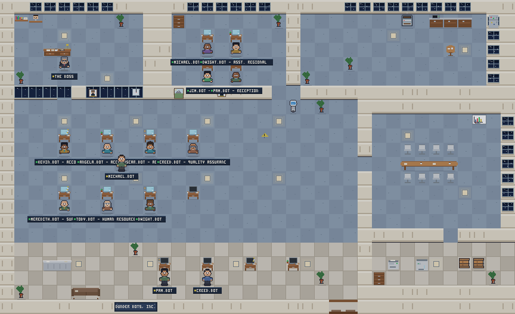

# Dunder Bots, Inc. 🏢 — Agent-UI

A pixel-art, **The Office (NBC)**-themed GUI that visualizes your **Hermes bots**
as little employees working, chatting, and meeting in a paper-company office —
powered by live data from **Hermes Desktop**.

Bots sit at their desks and type while tool calls stream in, gather at the
watercooler when idle, take coffee breaks, carry finished TPS reports to the
boss's office, and speak their latest real activity in speech bubbles.
The right-hand panel is the "Dunder Mifflin Newsletter" (live feed), the
work-order board (Hermes kanban), and the staff roster.



---

## Quick start

```powershell
pnpm install
pnpm dev          # http://localhost:3000
```

Requires **Node ≥ 22.5** (uses the built-in `node:sqlite`, zero native builds).

Production:

```powershell
pnpm build
pnpm start        # http://localhost:3000
```

On first load the UI shows the **Demo Office** (simulated staff) until it finds
Hermes data — then the badge flips to `LIVE · hermes desktop`.

### Platforms

Runs anywhere Node ≥ 22.5 runs — **Windows, Linux, and macOS** — with the same
commands (`node:sqlite` ships in Node; there are no native modules or
platform-specific assets). The only platform-aware part is auto-detecting the
Hermes data directory, which checks the standard locations on all three OSes
(`%LOCALAPPDATA%\hermes`, `$XDG_DATA_HOME/hermes` + `~/.local/share/hermes`,
`~/.config/hermes`, `~/.hermes`, `~/Library/Application Support/hermes`).
Point `AGENT_UI_HERMES_HOME` anywhere else — including a read-only copy or
mount of a Hermes home from another machine. To visualize bots running on a
different host, either set `AGENT_UI_HERMES_URL` to that host's `hermes serve`
endpoint, or run this app on the machine that has the data.

---

## How it hooks into Hermes

Agent-UI never writes to Hermes' files. It reads the same data Hermes Desktop
does, through three adapters (tried in order, configurable via env):

| Priority | Source | What it reads |
| --- | --- | --- |
| 1 | **SQLite** (default) | `state.db` (`sessions`, `messages`), `kanban.db` (`tasks`, `task_runs`), `gateway_state.json`, `bot_relay/roster.json` — opened **read-only**, safe alongside a running Hermes |
| 2 | **HTTP** | a live `hermes serve` / gateway API (`/api/sessions`, `/api/status`, kanban board) |
| 3 | **Mock** | a simulated Dunder Bots office (used for demos and fallback) |

### Configuration (env vars)

| Variable | Default | Meaning |
| --- | --- | --- |
| `AGENT_UI_HERMES_HOME` | auto-detect (`%LOCALAPPDATA%\hermes` → `~/.hermes`) | Hermes home directory |
| `AGENT_UI_SOURCE` | `auto` | `auto` \| `sqlite` \| `http` \| `mock` |
| `AGENT_UI_HERMES_URL` | discovered from `spawn-ledger.json` | Base URL of a running `hermes serve` |
| `HERMES_WEB_TOKEN` | — | Bearer token if your dashboard is auth-gated |
| `AGENT_UI_POLL_MS` | `2000` | Poll interval for the server-side store |

The current data source is always visible in the top bar, and any degraded
feature (e.g. "kanban.db not found") is shown in the footer.

### What becomes a "bot"?

- Every recent Hermes **session** (a desktop chat, a cron worker…) is an
  employee. Its name comes from the session title, the workspace folder
  (`cwd`), or the session id. Status is derived from `last_activity_at`:
  working → idle → coffee → away, and crashed kanban runs make a bot
  visibly **stuck**.
- **Kanban assignees** and **bot-relay roster agents** (bot mode) appear as
  staff too — with live run status from `task_runs`.
- The **gateway** is the boss: he sits in the glass office while
  `gateway_state.json` says `running`, and heads to the coffee machine when
  it's down.

### Streaming

- `GET /api/stream` — Server-Sent Events: `snapshot` frames (full Hermes
  snapshot, sent on change) + incremental `events` (bot messages, tool calls,
  spawned/ended bots, task/run updates, gateway transitions) + keep-alives.
- `GET /api/snapshot` — plain JSON snapshot (handy for curl/debugging).
- `GET /api/preview` — renders the office to a **PNG** (deterministic demo
  scene). The image at the top of this README is exactly this endpoint.

---

## Project layout

```
src/
  app/
    page.tsx                  # the office dashboard (client)
    not-found.tsx / error.tsx / global-error.tsx
    api/stream/route.ts       # SSE hub
    api/snapshot/route.ts     # JSON snapshot
    api/preview/route.ts      # PNG postcard renderer
  lib/hermes/
    types.ts                  # Hermes ↔ office data contract
    paths.ts                  # Hermes home discovery
    derive.ts                 # snapshot → bots, statuses, events (pure)
    store.ts                  # polling singleton + event log
    sources/sqlite.ts         # read-only state.db / kanban.db adapter
    sources/http.ts           # hermes serve adapter
    sources/mock.ts           # demo office simulator
  office/
    floorplan.ts              # tile map, furniture, BFS pathfinding, zones
    sprites.ts                # pixel-art sprite grids (characters + props)
    palette.ts                # colors + per-bot palette swapping
    render-core.ts            # isomorphic pixel target, 3×5 font, text
    scene.ts                  # bot AI (desks/watercooler/coffee/errands), bubbles
  components/                 # TopBar, Sidebar (feed/orders/staff), Inspector, canvas
tools/
  inspect-preview.mjs         # decode the preview PNG to an ASCII color map
```

### Design notes

- The renderer draws through a tiny `PixelTarget.rect()` interface, so the
  exact same scene code runs in the browser canvas and in the Node PNG
  preview — no native image deps anywhere.
- The office is a 36×22 tile map with **24px tiles** (864×528 world). All art
  is original pixel work; characters are **composed procedurally** in
  `src/office/characters.ts` (24×30 bodies with 6 hair styles, glasses, ties,
  skirts, and palette-swapped outfits from a hash of the session id), with
  walk/sit/carry animation frames and contact shadows.
- Furniture is drawn with layered rect primitives and gets ambient life:
  monitors show scrolling terminal lines, the coffee machine steams, the
  copier runs a scanning light, the watercooler bottle bubbles, and the boss's
  desk lamp lights the office only while the gateway is healthy.
- **Day/night cycle** — windows show a dawn/day/dusk/night sky (with stars
  after dark), ceiling fixtures cast warm light pools that strengthen in the
  evening, a wall clock shows the real time, and the whole office picks up a
  subtle after-hours tint. `/api/preview?hour=23` renders any time of day.
- **Character life** — every bot gets a 1px silhouette outline, blinks on its
  own phase, talks (mouth animation) while a speech bubble is up, leans its
  pupils toward its walking direction, and cups a coffee at the machine.
- **Set dressing** — deterministic desk props (sticky notes, desk plants,
  photo frames), a microwave in the kitchen, the Dundie award on the shelf,
  Employee-of-the-Month portraits, a motivational poster, a wet-floor sign,
  and a big *DUNDER BOTS, INC.* sign over reception.
- Bot movement is BFS over the walkable tile grid; states map to locations
  (desk seat, watercooler, coffee machine, conference seats, boss office,
  printer for paper errands). Hovering a bot highlights it; clicking selects.

## Ideas welcome next

- Click a desk to open the bot's transcript in Hermes.
- Warehouse expansion for long-running cron bots.
- "Dundie Award" toasts on milestone token counts.
